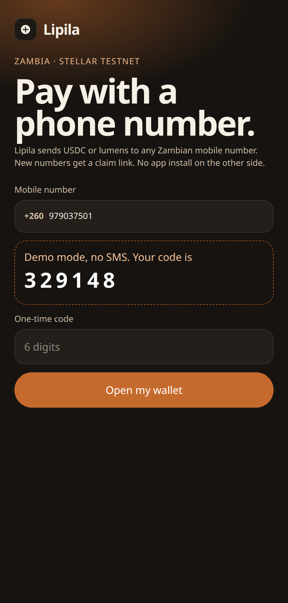
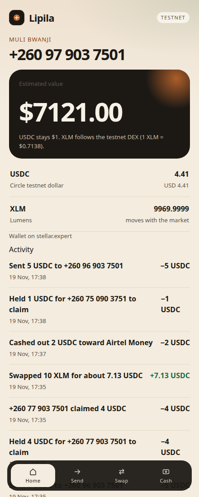
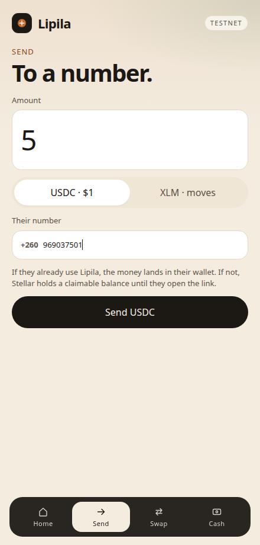
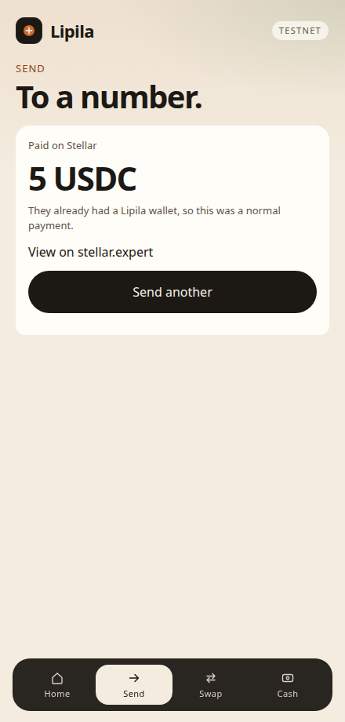
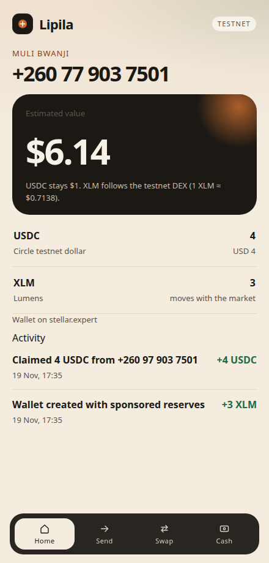
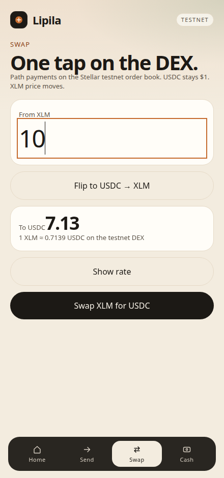
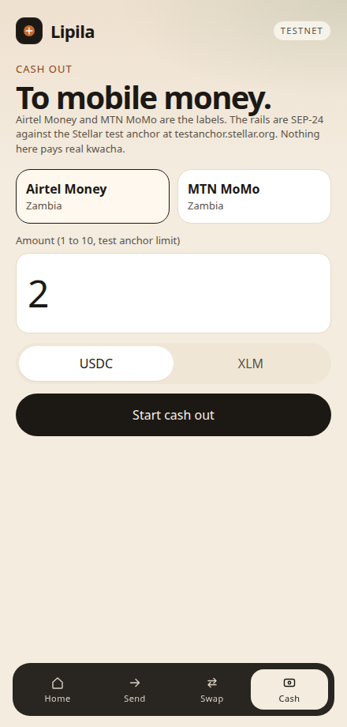
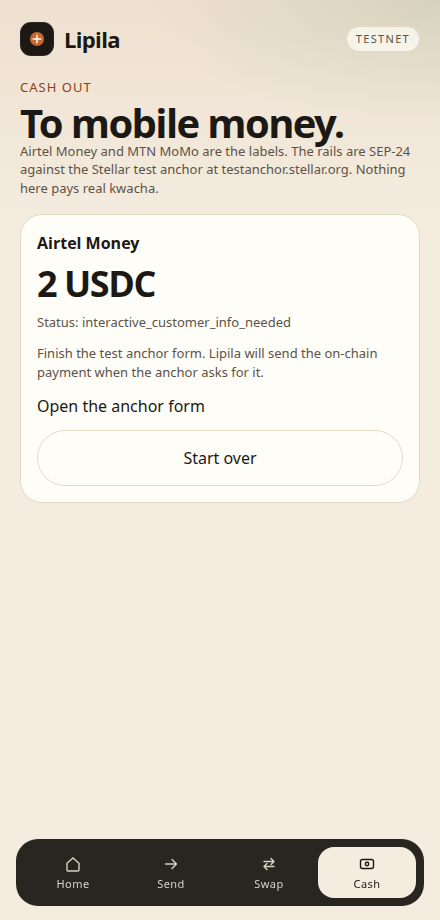
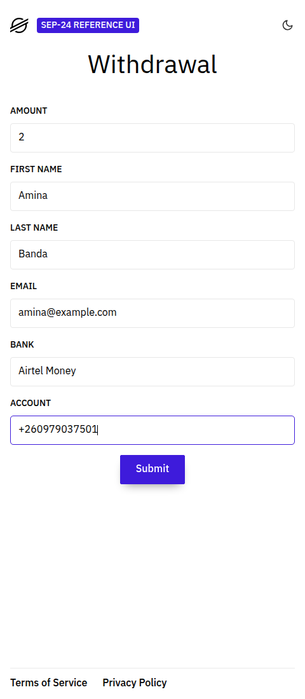
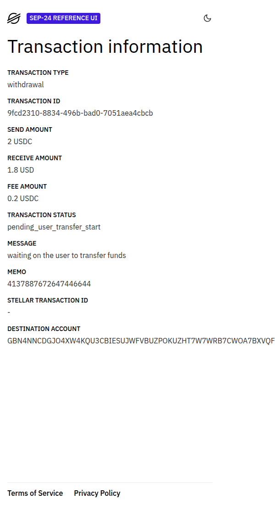

# Lipila

Lipila means “pay” in Nyanja and Bemba. It is a small testnet app for Zambia: send USDC or lumens (XLM) to someone using only their phone number, on the Stellar network.

It is a demo. The money is Stellar testnet. Nothing here is real kwacha, and there is no real SMS provider.

## What you can do

Five screens, plus the claim link a new recipient opens:

1. **Sign up** with a Zambian mobile number (`+260`). Lipila shows the one-time code on screen. The server creates a custodial testnet wallet, asks Friendbot for XLM, and opens a trustline to Circle’s testnet USDC.
2. **Home** shows USDC and XLM, an estimated dollar value, and activity. Every on-chain row links to [stellar.expert](https://stellar.expert/explorer/testnet) testnet.
3. **Send** a phone number, an amount, and USDC or XLM. If they already have a Lipila wallet, this is a normal Stellar payment. If they do not, Lipila creates a claimable balance they can take, and the sender can reclaim it after 7 days.
4. **Claim** is the link in the simulated text message. The new person verifies the same phone number, Lipila creates their account with sponsored reserves (they do not need XLM to exist), and the claimable balance is claimed into it.
5. **Swap** turns XLM into USDC or the other way in one tap, using a Stellar path payment against the testnet DEX. USDC stays $1. XLM moves with the testnet price.
6. **Cash out** starts a SEP-24 withdrawal to the Stellar test anchor (`testanchor.stellar.org`) labelled as Airtel Money or MTN MoMo. The anchor is a test system. It does not pay a real mobile-money wallet.

## How it sits on Stellar

| Piece | What Lipila does |
| --- | --- |
| Network | Testnet. Passphrase `Test SDF Network ; September 2015`. Horizon `https://horizon-testnet.stellar.org`. |
| XLM | [Friendbot](https://friendbot.stellar.org) creates and funds a new account. |
| USDC | Circle’s testnet USDC. Asset code `USDC`, issuer `GBBD47IF6LWK7P7MDEVSCWR7DPUWV3NY3DTQEVFL4NAT4AQH3ZLLFLA5` ([Circle’s Stellar transfer quickstart](https://developers.circle.com/stablecoins/quickstarts/transfer-usdc-stellar)). The issuer does not require authorization, so a trustline is enough. |
| Someone new | `createClaimableBalance` with two claimants: the recipient can claim any time, and the sender can claim only after 7 days (`not` + `before_relative_time`). |
| Sponsored claim | A platform sponsor account (also Friendbot-funded) wraps `beginSponsoringFutureReserves`, `createAccount` with a zero starting balance, the USDC trustline, and `endSponsoringFutureReserves`, then claims the balance in the same transaction. The sponsor also pays a few XLM so the new wallet can cover later fees. |
| Swap | Horizon strict-send pathfinding, then `pathPaymentStrictSend` with about 1.5% slippage. |
| Cash out | SEP-10 challenge signed by the custodial key, then SEP-24 `POST /transactions/withdraw/interactive` as JSON. When the anchor status is `pending_user_transfer_start`, Lipila pays the anchor account with the memo the anchor returned. |
| Keys | Secret keys are encrypted with AES-256-GCM before they are stored. The key is `WALLET_ENCRYPTION_KEY`. It is never written into the repo. |

On signup, Lipila asks the public Circle faucet for test USDC. In the recorded demo the faucet did not deliver, so the wallet bought starter USDC with a path payment of 20 XLM. That USDC is still Circle’s testnet asset, because that is what the testnet order book trades.

## Run it locally

```bash
npm install
cp .env.example .env.local
```

Put real values in `.env.local`:

```bash
node -e "console.log(require('crypto').randomBytes(32).toString('hex'))"
```

Use one line for `WALLET_ENCRYPTION_KEY` and another for `SESSION_SECRET`. Leave `DEMO_MODE=true` so the one-time code is shown on screen.

```bash
npm run dev
```

Open http://localhost:3000. The first sign-in takes a few seconds while Friendbot and the trustline confirm.

Without `DATABASE_URL`, local data is a JSON file in `.data/`. That directory is gitignored. It only works where the process can write to disk.

## Storage

Lipila picks one store at startup:

1. **`DATABASE_URL`** — any Postgres. Tables are created on startup from `netlify/database/migrations/20261119170000_init/migration.sql`.
2. **`NETLIFY_DB_URL`** — set by Netlify when this app is deployed. `@netlify/database` is a dependency so Netlify Database is provisioned, and the deploy applies the migration. The app does not run `CREATE TABLE` against that database.
3. **JSON file** — demo fallback for `next dev` on a writable machine. On Netlify, if neither database URL is present, the app stops with an error instead of writing to the read-only filesystem.

Wallet secrets in every store are ciphertext. Sessions are random tokens; only a hash is stored.

## Deploy on Netlify

`netlify.toml` builds with `npm run build` and publishes `.next`. Netlify’s Next.js runtime serves the App Router and the route handlers.

In the Netlify UI, set:

- `WALLET_ENCRYPTION_KEY` — 32-byte hex or base64
- `SESSION_SECRET` — a long random string
- `DEMO_MODE` — `true` for this demo (the code is shown on screen), `false` only if you add a real SMS sender
- `APP_URL` — the public site URL, used in claim links

Do not put those secrets in `netlify.toml`. Postgres comes from Netlify Database (`NETLIFY_DB_URL`) or from `DATABASE_URL` if you bring your own.

## Scripts

```bash
npm test
npm run lint
npm run build
```

Tests cover phone numbers, amounts, encryption, the 7-day reclaim rule, claimable-balance predicates, and the in-memory store.

## Demo, as run on testnet

Phones used:

| Person | Number | Account |
| --- | --- | --- |
| Alice (sender) | +260 97 903 7501 | `GCEW2ARI6IOY5IVM6BKYA33XPMUTRWXL3UOX3P7YXSQQEP2Y7QWDUKPK` |
| Brian (already on Lipila) | +260 96 903 7501 | `GBKBRSUNJVS4L522Z7UA3NJO5QVT4V6GQ5IKQT44X5GFTUCUD5ZUN66Q` |
| Chipo (new, claimed) | +260 77 903 7501 | `GDGWM322ATKDHY5HYZTEXGV3DOP65MVJDXMBABZRGYB5USCC6A43RPRI` |

Walkthrough:

1. Alice and Brian each signed in. Friendbot funded them, each opened a USDC trustline, and each bought starter USDC with 20 XLM because the Circle faucet returned nothing.
2. Alice sent **5 USDC** to Brian. He already had a wallet, so this was a payment.
3. Alice sent **4 USDC** to Chipo, who had no account. Stellar held a claimable balance.
4. Chipo opened the claim link, entered the on-screen code, and the sponsor account created her wallet and claimed the 4 USDC in one transaction. She also received 3 XLM for later fees. She did not need XLM beforehand.
5. Alice swapped **10 XLM** for about **7.13 USDC** at roughly 0.7139 USDC per XLM.
6. Alice cashed out **2 USDC** toward Airtel Money. SEP-10 and SEP-24 ran against `testanchor.stellar.org`. The reference UI asked for a name and an account, then waited in `pending_user_transfer_start`. Lipila paid the anchor. The anchor then reported the withdrawal **completed**. The “1.8 USD” on that screen is the anchor’s own test fee schedule (0.2 USDC). It is not a mobile-money payout.

### Transactions

All of these succeeded on Horizon. The full list is also in [`evidence/transactions.json`](evidence/transactions.json).

- Friendbot, Alice — https://stellar.expert/explorer/testnet/tx/0cfcb0741322781057e111fc66854438915d3f36b5e61eec85e84eefdaa53f4b
- USDC trustline — https://stellar.expert/explorer/testnet/tx/df4c5396afbd890aa124e9bd82fd8047e62a29f83cfc5468fad8ad330b3828e7
- Starter USDC path payment (20 XLM) — https://stellar.expert/explorer/testnet/tx/dde20ee43ca962c6692888efb44169a04dc18b965d45aaa71f241528fd34c284
- **5 USDC to an existing user** — https://stellar.expert/explorer/testnet/tx/94c745c9799f75525b264e4bbcae18267a7cd4f2cfef67ca35bd47fd833aa209
- **Claimable balance for a new number** — https://stellar.expert/explorer/testnet/tx/0f49bd972dc5435c3edb913c9146eb0db0da7d71b2dabd5c036ea3cf91c7d2a6
- **Sponsored create + claim** — https://stellar.expert/explorer/testnet/tx/bc07f38ed770355d9d2ecffe867851f9a83286e47e7ce8a080d95e909625fbf0
- **Swap 10 XLM → USDC** — https://stellar.expert/explorer/testnet/tx/0daed7aba466a0b390b6496b7150ae2af8417f2571ce3d32df049bda5a8aa3e9
- **SEP-24 anchor payment, 2 USDC** — https://stellar.expert/explorer/testnet/tx/a4e5366bb0846fb19979d9100095b8592e1eb9f591279734dce0addeec54f397

Anchor transaction id: `9fcd2310-8834-496b-bad0-7051aea4cbcb` on `testanchor.stellar.org`, status `completed`.

A later 5 USDC payment, the one in the receipt screenshot: https://stellar.expert/explorer/testnet/tx/21ea70dbacf1ae0bab9b37ee2481e35ace8ed7ed6c567afd3ec9523637128d7d

The open claim page screenshot is a separate 1 USDC claimable balance: https://stellar.expert/explorer/testnet/tx/9099cfbf242649465bb8b4125874e50ca31626f2bb4b0aa0e62fcab36aebc718

### Screens























## Not in this demo

- No real SMS. Codes are shown because `DEMO_MODE` is on.
- No real Airtel or MTN payout. SEP-24 stops at the Stellar test anchor.
- Custodial keys. Lipila holds them, encrypted. This is a testnet demo, not a production wallet.
- The Circle faucet is attempted and may be rate-limited. The DEX path is the backup for starter USDC.
